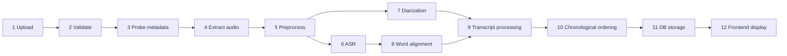

# AI Processing Pipeline Design

| Field | Value |
|---|---|
| Document ID | AIP-001 |
| Version | 0.1.0 |
| Status | Design only - Part 1 |
| Last updated | 2026-11-20 |
| Related documents | `TECHNOLOGY_EVALUATION.md`, `SYSTEM_ARCHITECTURE.md`, `PROJECT_REQUIREMENTS.md`, `DATABASE_DESIGN.md`, `TECHNICAL_RISKS.md`, `ARCHITECTURE_DECISIONS.md` |

> **Implementation status:** None of the stages below is implemented. Accuracy, speed, and sync figures are targets or published third-party claims, not measurements from this project. No test result is fabricated here.

---

## 1. Pipeline overview

| Stage | Name | Primary output |
|---|---|---|
| 1 | Video upload | Temporary uploaded file |
| 2 | File validation | Accepted/rejected media with reason |
| 3 | Metadata extraction | `media.json` + video metadata row |
| 4 | Audio extraction | 16 kHz mono WAV + audio offset |
| 5 | Audio preprocessing | Validated, normalized audio + VAD segments |
| 6 | Speech recognition | `asr.json` (text, language, segments, optional words) |
| 7 | Speaker diarization | `diarization.json`/RTTM (speaker turns) |
| 8 | Word-level alignment | `alignment.json` (word times + quality) |
| 9 | Transcript processing | Speaker attribution + readable segments |
| 10 | Chronological ordering | Canonical ordered transcript |
| 11 | Database storage | Persisted speakers, segments, words |
| 12 | Frontend display | Synchronized player + transcript |

ASR (6) and diarization (7) are independent after preprocessing and may run in parallel. Alignment (8) depends on ASR. Speaker attribution in stage 9 requires both alignment and diarization. The numbering follows the project brief's logical order; it is not a requirement that stages 6 and 7 execute serially.



---

## 2. Stage specifications

### Stage 1 - Video upload

- **Input:** `multipart/form-data` request containing one video and optional title/language/speaker hints.
- **Processing logic:** Enforce `Content-Length` limit early when present; stream chunks to `storage/tmp/{upload_id}.part`; count bytes while writing; abort and delete the partial file when the limit is exceeded or the client disconnects; fsync on completion; atomically move into place after validation; compute SHA-256 while streaming.
- **Output:** Temporary/original file, byte size, checksum, client filename, declared MIME type.
- **Dependencies:** FastAPI multipart parsing, storage adapter, request ID, configuration limits.
- **Potential failures:** Connection drop, body larger than limit, disk full, permission error, duplicate concurrent upload, request timeout.
- **Error handling:** `UPLOAD_ABORTED`, `FILE_TOO_LARGE` (413), `STORAGE_FULL` (507), `STORAGE_WRITE_FAILED` (500). Delete partial files. Do not create a meeting before validation succeeds.
- **Testing:** Boundary sizes (0, 1 byte, exactly limit, limit+1), interrupted stream, missing filename, path-traversal filename, concurrent uploads, disk-full simulation.

### Stage 2 - File validation

- **Input:** Uploaded file and declared metadata.
- **Processing logic:** Check extension allowlist, declared MIME type, basic magic bytes, then run `ffprobe -v error -print_format json -show_format -show_streams`. Verify: readable container, positive duration within cap, at least one audio stream, at least one video stream, supported codecs, browser-playable combination, no encrypted streams. Treat extension/MIME as hints only.
- **Output:** Validated `MediaInfo` (format, duration, streams, codecs, browser compatibility) or a rejection with a stable code.
- **Dependencies:** FFprobe, allowlist configuration.
- **Potential failures:** Corrupt container, misleading extension/MIME, unsupported codec, multiple/odd streams, zero duration, encrypted DRM, FFprobe timeout.
- **Error handling:** `UNSUPPORTED_FORMAT` (415), `UNPROCESSABLE_MEDIA` (422), `NO_AUDIO_STREAM`, `DURATION_EXCEEDED`, `NOT_BROWSER_PLAYABLE`. Rejected uploads leave no meeting row; the temp file is removed.
- **Testing:** Valid MP4/WebM/MOV, audio-only, video-only, renamed `.mp4` text file, truncated MP4, DRM sample, zero-byte file, Unicode filename, very long duration metadata.

### Stage 3 - Metadata extraction and persistence

- **Input:** Validated file, `MediaInfo`.
- **Processing logic:** Normalize codec/container names, select the default audio stream, record stream start times, duration, dimensions, sample rate, channels, bitrate, and checksum. Create `Meeting`, `Video`, and initial queued `ProcessingJob` rows in one transaction. Store only relative paths.
- **Output:** Persisted meeting/video/job; `media.json` artifact.
- **Dependencies:** Database session, storage adapter, clock/ID generator.
- **Potential failures:** DB lock, transaction failure after file move, clock skew, unexpected FFprobe fields.
- **Error handling:** Roll back the transaction and quarantine the stored file for cleanup; return `INTERNAL_ERROR`; never leave a meeting with no video row.
- **Testing:** Transaction rollback, concurrent SQLite writes, missing optional metadata, negative/non-zero start times, path normalization, repeated identical uploads (distinct meetings, same checksum allowed).

### Stage 4 - Audio extraction

- **Input:** Validated original video, selected audio stream index, timeline metadata.
- **Processing logic:** Run FFmpeg with an argument vector: select one audio stream, drop video/subtitle/data, downmix to mono, resample to 16 kHz, encode `pcm_s16le`. Do not use `-copyts`; compute the audio-to-presentation offset from FFprobe instead. Verify the WAV with FFprobe.
- **Output:** `storage/audio/{meeting_id}/audio_16k_mono.wav`, `audio.json` with sample rate, channels, duration, source stream index, and `audio_start_offset_ms`.
- **Dependencies:** FFmpeg/FFprobe, storage, timeout configuration.
- **Potential failures:** Unsupported decoder, corrupt audio packets, no decodable frames, disk full, FFmpeg hang/OOM, WAV verification mismatch.
- **Error handling:** Kill the process on timeout; capture stderr tail; `MEDIA_EXTRACTION_FAILED`, `AUDIO_VERIFICATION_FAILED`, `STORAGE_FULL`. Keep the original for retry.
- **Testing:** AAC/Opus/MP3 inputs, stereo-to-mono, 44.1/48 kHz inputs, non-zero audio start offset, multiple audio streams, corrupted audio, timeout, output verification. Validate waveform duration against container duration within tolerance.

### Stage 5 - Audio preprocessing

- **Input:** 16 kHz mono WAV.
- **Processing logic:** Confirm sample format, duration, and non-silence. Compute basic diagnostics (peak, clipping ratio, RMS, leading/trailing silence). Optional conservative loudness normalization. Run or configure VAD according to the ASR engine. Do not apply aggressive noise reduction by default because it can remove speech cues needed by diarization.
- **Output:** Preprocessed WAV (if normalization is enabled), `preprocess.json` diagnostics, speech/silence regions.
- **Dependencies:** FFmpeg filters or Python audio library, VAD (Silero via WhisperX/faster-whisper), configuration.
- **Potential failures:** Entirely silent audio, severe clipping, DC offset, pathological duration, normalization introducing artifacts.
- **Error handling:** If all audio is silent, complete with an empty transcript and `warning_code=NO_SPEECH_DETECTED`, or fail according to configuration; document the choice. Diagnostics are always persisted.
- **Testing:** Silence, near-silence, clipped speech, varying gain, noise, music-only, very short audio (<1 s), VAD boundary behavior.

### Stage 6 - Speech recognition

- **Input:** Normalized WAV, language hint or auto-detect, ASR configuration.
- **Processing logic:** Load the Whisper model through WhisperX (faster-whisper backend). Use VAD-aware batched inference. Set beam size, batch size, compute type, no-speech threshold, compression ratio threshold, and condition-on-previous-text behavior explicitly. Auto-detect language unless supplied. Persist raw output before filtering.
- **Output:** `asr.json` with `schema_version`, model/revision, device, compute type, detected language and probability, segments, optional word tokens, probabilities, and timing.
- **Dependencies:** WhisperX, faster-whisper/CTranslate2, model cache, CPU or CUDA runtime, enough RAM/VRAM.
- **Potential failures:** Model download failure, missing CUDA/cuDNN, OOM, very long audio, hallucination loops, silence, language misdetection, tokenizer/model mismatch.
- **Error handling:** `ASR_MODEL_UNAVAILABLE`, `RESOURCE_EXHAUSTED`, `ASR_FAILED`, `ASR_TIMEOUT`. Retry once with a smaller batch; if the failure is model-load related, retry with the configured fallback model. Filter only high-confidence hallucination patterns and record every dropped span.
- **Testing:** Clean English fixture, accented speech, noisy speech, two languages, silence, 10-minute and 4-hour synthetic durations, low-memory mode, model download preflight, deterministic output with temperature 0 (where supported).

### Stage 7 - Speaker diarization

- **Input:** Normalized WAV, optional speaker-count hints, HF token, model configuration.
- **Processing logic:** Load pyannote.audio pipeline, move to the chosen device, run with optional `min_speakers`/`max_speakers`. Persist raw turns with engine-local labels (`SPEAKER_00`, ...). Use `exclusive_speaker_diarization` when the selected pipeline exposes it, while retaining the regular diarization for overlap analysis.
- **Output:** `diarization.json` and optional RTTM with turns `(start_s, end_s, raw_label)` plus model metadata.
- **Dependencies:** pyannote.audio, gated Hugging Face model, HF token, model cache, torch, audio.
- **Potential failures:** Missing/invalid token, terms not accepted, model download blocked, version incompatibility, OOM, speaker-count error, pathological turn fragmentation.
- **Error handling:** Retry once on transient download/runtime errors. On permanent failure, apply the configured degraded mode: all words under `Speaker 1`, `diarization_status=degraded_single_speaker`, warning surfaced in API/UI. If strict mode is enabled, fail with `DIARIZATION_FAILED`.
- **Testing:** 1, 2, 3, and 5-speaker fixtures; overlapping speech; similar voices; short turns; long silence; missing token; model gating; CPU and GPU if available; compare turn count and DER on a consented sample.

### Stage 8 - Word-level alignment

- **Input:** ASR segments, WAV, detected language.
- **Processing logic:** Use WhisperX forced alignment with a language-specific wav2vec2 model. Align words to audio; preserve punctuation tokens; mark tokens that cannot be aligned. If the language has no supported alignment model, or alignment fails, fall back to faster-whisper word timestamps; if those are unavailable, use segment-level timing only. Apply no timeline offset yet.
- **Output:** `alignment.json` with per-word start/end (audio-relative seconds), `timing_source`, unaligned tokens, and `alignment_quality`.
- **Dependencies:** WhisperX alignment, torchaudio/Hugging Face alignment model, ASR output, language metadata.
- **Potential failures:** Unsupported language, model download failure, OOM, alignment exception, words outside the model dictionary (numbers, currency, acronyms), long files, text/audio mismatch.
- **Error handling:** Degrade in the documented ladder; never fail the entire job for alignment when segment timing is available. Set `alignment_quality=estimated_word` or `segment_only` and record the reason. Tokens without timing get `start_ms=NULL`/`end_ms=NULL`.
- **Testing:** English clean audio, unsupported language fallback, numeric/currency tokens, unaligned tokens, long audio, model unavailable, compare aligned boundaries against synthetic markers, ensure monotonic non-overlapping word times.

### Stage 9 - Transcript processing

- **Input:** Aligned words/segments, diarization turns, language, audio offset.
- **Processing logic:** (a) Convert audio-relative times to media-relative times once; (b) assign a speaker to each word by maximum turn overlap with deterministic tie-breaks; (c) mark overlaps when the engine exposes overlapping turns; (d) group words into readable segments; (e) map raw speaker labels to meeting labels by first appearance; (f) preserve all text and record counts of unaligned/unknown words.
- **Output:** In-memory canonical transcript plus `transcript_raw.json`; counts for diagnostics.
- **Dependencies:** Stage 6/7/8 artifacts, transcript assembler, offset metadata, configuration thresholds.
- **Potential failures:** Empty diarization, zero-overlap words, speakers with very short turns, inconsistent tokenization, missing punctuation, segment explosion, all-unknown speakers.
- **Error handling:** Deterministic fallbacks: `UNKNOWN` speaker for words with no nearby turn; merge tiny segments; cap segment length; if no words exist, produce an empty transcript with a warning. Never discard text silently.
- **Testing:** Word/turn boundary cases, tie-breaking, overlap, gaps, one speaker, unknown speaker, punctuation-only tokens, unaligned tokens, offset application exactly once, idempotency.

### Stage 10 - Chronological ordering

- **Input:** Processed segments and words.
- **Processing logic:** Sort by `(start_ms, original_word_index, segment_index)`. Validate monotonic ordering, non-negative times, `start <= end`, and containment of words within segments. Merge adjacent same-speaker segments only when thresholds allow. Detect and resolve duplicate tokens introduced by chunk overlap.
- **Output:** Canonically ordered transcript.
- **Dependencies:** Stage 9 output, invariant validator.
- **Potential failures:** Ties at identical timestamps, chunk-overlap duplicates, zero-length segments, end times beyond duration.
- **Error handling:** Stable deterministic sort; drop exact duplicate token IDs only (never text-based dedupe); clamp end times; fail the job if invariants cannot be repaired.
- **Testing:** Identical timestamps, out-of-order input, duplicate chunk words, words beyond duration, single-word segments, 4-hour synthetic transcript performance.

### Stage 11 - Database storage

- **Input:** Canonical transcript, speaker list, meeting/job IDs.
- **Processing logic:** In one transaction: delete any previous transcript for the meeting, insert speakers with ordinals, insert segments and words in batches, update meeting status to `completed`, record quality flags, and mark the job succeeded. Use batch inserts and enable foreign keys.
- **Output:** Persisted transcript; API can serve it immediately.
- **Dependencies:** SQLAlchemy session, schema/migrations, SQLite WAL.
- **Potential failures:** DB locked, disk full, constraint violation, process crash mid-transaction, duplicate speaker ordinal.
- **Error handling:** Roll back the whole transaction on any failure. Preserve the previous transcript until the new one commits. `DB_WRITE_FAILED`/`STORAGE_FULL`; job retry is safe because the transaction is atomic.
- **Testing:** Rollback injection, concurrent status reads during commit, duplicate reprocessing, foreign-key enforcement, batch size limits, 36k-word transcript, crash simulation.

### Stage 12 - Frontend display and synchronization

- **Input:** Meeting metadata, transcript API response, video stream.
- **Processing logic:** Render segments; track `currentTime` using `requestAnimationFrame` while playing; binary-search active segment; seek on timestamp click; auto-scroll with a Follow toggle; show quality/degraded notices.
- **Output:** Synchronized interactive transcript.
- **Dependencies:** Next.js, TanStack Query, HTML5 video, Range-capable stream, transcript API.
- **Potential failures:** Browser codec unsupported, Range endpoint broken, stale polling, clock drift, transcript load failure, huge DOM.
- **Error handling:** Show explicit video/transcript errors; retry queries; fall back to native player if sync fails; virtualize long transcripts if needed.
- **Testing:** Click-to-seek accuracy, highlight boundaries, pause/resume, seeking while paused, browser matrix, 2k+ segments, degraded alignment, no transcript, deleted meeting.

---

## 3. Speaker attribution algorithm (stage 9 detail)

Inputs: word intervals `W`, diarization turns `T` with raw labels. If the engine provides exclusive diarization, use it for attribution and the regular diarization for overlap detection.

For each word `w = [s, e]`:

1. Compute overlap duration with every turn from a different raw speaker.
2. Let `best` be the turn with the largest overlap.
3. Accept `best` if `overlap >= max(50 ms, 0.25 * (e - s))`.
4. If no turn meets the threshold, choose the nearest turn within a 500 ms gap, preferring the previous word's speaker when still active.
5. Otherwise assign `UNKNOWN`.
6. If at least two distinct speakers each overlap the word by at least 100 ms, mark `is_overlap=1`; still assign the dominant speaker.
7. Record `attribution_rule` per word in the artifact: `overlap`, `nearest`, `previous`, or `unknown`.

### Speaker label ordering

1. Order speakers by the earliest word start attributed to them (first appearance).
2. Break ties by total attributed speech duration (descending), then raw engine label (ascending).
3. Persist labels as `Speaker 1..N`; maintain a mapping table/artifact from raw labels.
4. Do not create a speaker row with zero attributed words.

This guarantees deterministic, meeting-scoped labels. It does not guarantee that the labels match real people or that the engine's speaker count is correct.

### Segment grouping

Start a new segment when any condition holds:

- Speaker changes.
- Gap between consecutive words exceeds 800 ms.
- Current segment exceeds 15 seconds.
- Current segment exceeds 240 display characters.
- Sentence-ending punctuation (`.`, `?`, `!`) is followed by a gap of at least 400 ms.
- A hard ASR segment boundary is crossed **and** the gap is at least 300 ms.

Merge adjacent same-speaker segments when the gap is under 300 ms and the merged segment stays within the duration/character limits. Segment start is the first word start; end is the last word end. No synthetic padding is added by default. All thresholds are configuration values, recorded in the artifact manifest.

---

## 4. Artifact schemas and resume strategy

All artifacts are JSON with a `schema_version` and are written atomically (temp file + rename).

| Artifact | Required contents |
|---|---|
| `media.json` | Format, duration, streams, codecs, start times, checksum. |
| `audio.json` | WAV path, sample rate, channels, duration, source stream, offset. |
| `preprocess.json` | Diagnostics, VAD regions, normalization settings. |
| `asr.json` | Model/revision, device, compute type, language, segments, words. |
| `diarization.json` | Pipeline/model revision, turns, raw labels, speaker hints. |
| `alignment.json` | Alignment model, word times, timing sources, quality. |
| `transcript_raw.json` | Canonical segments/words before DB insertion, counts, warnings. |
| `run.json` | Job ID, input checksum, config hash, versions, stage timings, errors. |

**Resume rules:** A job may reuse an artifact only when the input checksum, relevant configuration, and engine version match. Artifacts are versioned; mismatches trigger regeneration. This avoids silently mixing results from different models or settings.

**Retention:** Artifacts are retained for a configurable period (default: until meeting deletion) to support debugging and reprocessing. Audio and artifacts can be regenerated from the original, so they are excluded from backups in the MVP.

---

## 5. WhisperX suitability assessment

### 5.1 What WhisperX provides

- Batched faster-whisper ASR with VAD.
- Word-level timestamps via wav2vec2 phoneme-based forced alignment.
- pyannote.audio diarization integration.
- Word-to-speaker assignment (`assign_word_speakers`).
- Language-specific alignment model selection.
- BSD-2-Clause license for WhisperX itself.

This is the closest existing integration to the required pipeline and is the recommended MVP orchestrator, **behind adapters**.

### 5.2 What it does not solve

WhisperX is not a turnkey accuracy guarantee. Its own documentation acknowledges:

- Words containing characters outside the alignment model's dictionary (for example `"2014."` or `"£13.60"`) may receive no timing.
- Overlapping speech is not handled well.
- Diarization is "far from perfect".
- A language-specific wav2vec2 model is required.

Additional integration work is mandatory:

1. **Version pinning:** WhisperX, faster-whisper, CTranslate2, PyTorch, torchaudio, pyannote.audio, NumPy, and CUDA/cuDNN must be pinned and tested together. The ML dependency graph is the largest installation risk in the project.
2. **Model licensing and gating:** The current WhisperX diarization path uses `pyannote/speaker-diarization-community-1` (CC-BY-4.0) and requires a Hugging Face token plus acceptance of model conditions. Older configurations use `speaker-diarization-3.1` (MIT, also gated). The team must record the choice and attribution obligations.
3. **Offline preflight:** Download ASR, alignment, and diarization weights before the demo; verify hashes and load them from the local cache. Do not depend on conference Wi-Fi.
4. **Canonical schema:** Never persist WhisperX's raw dictionaries directly. Convert them to our versioned artifacts so the engine can be replaced.
5. **Speaker mapping:** WhisperX returns raw labels; our deterministic `Speaker N` mapping and persistence are separate.
6. **Re-segmentation:** WhisperX segments can contain multiple speakers or awkward boundaries. Words must be regrouped after speaker attribution.
7. **Overlap and gaps:** Implement explicit overlap flags and unknown-speaker handling; do not assume every word has a turn.
8. **Timeline offset:** WhisperX times are audio-relative. Apply the FFprobe-derived offset exactly once, after alignment.
9. **Fallbacks:** Build the alignment and diarization fallback ladders; a missing optional model must not corrupt the job.
10. **Memory management:** Free ASR/alignment/diarization models between stages on constrained GPUs; expose batch size and compute type.
11. **Hallucination filtering:** VAD and decoding thresholds are necessary but not sufficient; add loop detection and persist dropped spans.
12. **Evaluation:** Measure WER, DER, and timestamp error on fixtures; never infer quality from vendor claims.

### 5.3 Verdict

**Suitable for the MVP, conditionally.** Use WhisperX as the orchestration layer for ASR, alignment, and diarization integration, while keeping the three engines behind interfaces. If dependency conflicts become unmanageable, the fallback plan is direct faster-whisper + pyannote.audio + a custom reconciliation/alignment layer. The database, API, and UI designs do not depend on WhisperX.

---

## 6. Mapping audio timestamps to the original video timeline

### 6.1 Definitions

- `format.start_time`: container presentation start reported by FFprobe (seconds; may be `N/A` or negative with edit lists).
- `audio_stream.start_time`: first audio sample timestamp in container time.
- `video_stream.start_time`: first video frame timestamp in container time.
- `t_wav`: time reported by ASR/alignment relative to the extracted WAV, whose first sample is 0.
- `t_media`: time on the HTML5 video timeline (`video.currentTime`).

### 6.2 Extraction rule

The WAV is extracted without `-copyts`, so FFmpeg writes a new timeline starting at 0 for the selected audio stream. The first WAV sample corresponds to the audio stream's first sample in the container. The presentation start is the container's `format.start_time` (or 0 when unavailable).

```text
media_start_s = valid(format.start_time) ? format.start_time : 0
audio_start_s = valid(audio_stream.start_time) ? audio_stream.start_time : media_start_s
offset_ms     = round((audio_start_s - media_start_s) * 1000)
t_media_ms    = clamp(round(t_wav * 1000) + offset_ms, 0, duration_ms)
```

`video_stream.start_time` is recorded for diagnostics. In normal MP4 recordings, `format.start_time`, `audio_stream.start_time`, and `video_stream.start_time` are all 0 (or within a few milliseconds), so the offset is approximately zero.

### 6.3 Rules and caveats

1. Apply the offset **once**, in stage 9, before persistence. Never apply it in both alignment and assembly.
2. Clamp negative results to 0 and record `pre_roll_clamped_ms`. Clamping hides media that starts before the browser's zero point; this is rare and must be visible in diagnostics.
3. Do not use `-copyts` unless the mapping formula is redesigned and tested; mixing approaches is a common source of double offsets.
4. Edit lists and negative start times can make container timing counterintuitive. `ffprobe` must be the authority; browser behavior must be measured, not assumed.
5. Variable frame rate video does not affect audio sample timing, but it can affect visual sync checks. Use audio markers for timestamp validation.
6. If the audio stream is delayed relative to video, the positive offset shifts transcript times later, matching what the viewer hears.
7. If multiple audio streams exist, only the selected stream is transcribed; report which stream was used.
8. If a playback proxy is ever generated, its timeline must preserve the original presentation timeline or store a proxy-specific offset. This is future work.

### 6.4 Validation method

Create a consented synthetic fixture with spoken numbers or tones at known positions (for example 5 s, 30 s, 60 s) plus a visual marker. Assert:

- The word/segment containing the marker is within the tolerance target.
- The offset is zero on a normal MP4 and non-zero on a crafted file with a delayed audio stream.
- Seeking to a segment start lands within the active segment.
- The final word end does not exceed media duration.

Tolerance targets (to be validated, not guarantees): segment start within ±500 ms, word boundary within ±300 ms on clean audio.

---

## 7. Model and runtime configuration

| Setting | GPU recommendation | CPU fallback |
|---|---|---|
| ASR model | Whisper `large-v3` via faster-whisper | `small` or `base` |
| Compute type | `float16` (or `int8_float16`) | `int8` |
| Batch size | 8-16, reduce on OOM | 1-4 |
| VAD | Enabled | Enabled |
| Alignment | wav2vec2 for detected language | Same, if RAM allows; otherwise skip |
| Diarization | pyannote community-1 on CUDA | pyannote on CPU, slower |
| Concurrency | One job per GPU | One job total |

**Hardware status:** The team's hardware and GPU availability are **unknown** and are recorded as unresolved in `ARCHITECTURE_DECISIONS.md`. Published figures (for example faster-whisper's benchmark of a 13-minute file in about 17-63 seconds on an RTX 3070 Ti 8 GB, depending on batching/precision) are third-party claims, not this project's measurements. The design must run on CPU, accept lower quality/speed, and allow model/batch overrides.

**Version policy:** Pin exact versions in Part 2 after a compatibility spike. Record them in `run.json`, `requirements.lock`, and the academic report. Do not assume the latest versions of PyTorch, pyannote.audio, CTranslate2, and WhisperX are mutually compatible.

**Licensing summary (verify at Part 2):**

| Component | License / requirement |
|---|---|
| OpenAI Whisper code/weights | MIT |
| faster-whisper | MIT |
| WhisperX | BSD-2-Clause |
| pyannote.audio library | MIT |
| `pyannote/speaker-diarization-community-1` | CC-BY-4.0, gated, HF token, attribution required |
| `pyannote/speaker-diarization-3.1` | MIT, gated, HF token; requires accepting related model conditions |
| wav2vec2 alignment checkpoints | Varies by checkpoint; verify each model card |
| Silero VAD | MIT (verify bundled version) |
| FFmpeg | LGPL-2.1+ or GPL depending on build/configure flags; verify distribution |

---

## 8. Quality expectations and evaluation plan

The system must not claim perfect results. Planned evaluation:

| Metric | Method | Status |
|---|---|---|
| WER | Compare against a manually corrected, consented fixture transcript using `jiwer` or equivalent. | Planned |
| DER | Compare diarization against RTTM ground truth using `pyannote.metrics`, no forgiveness collar, including overlap. | Planned |
| Speaker-count accuracy | Compare detected count to ground truth on 1-5 speaker fixtures. | Planned |
| Timestamp error | Synthetic markers at known times; measure segment and word boundary error. | Planned |
| Sync accuracy | Click-to-seek and highlight boundary tests in the browser. | Planned |
| Runtime/memory | Measure per stage on actual hardware and model configuration. | Planned |

Report the dataset, language, duration, hardware, model versions, and parameter values with every metric. Do not generalize beyond the tested sample.

Known limitations to state in the UI and report:

- Accuracy decreases with noise, reverberation, clipping, crosstalk, accents, and domain vocabulary.
- Speaker labels are anonymous and may be wrong or merge/split speakers.
- Overlapping speech is poorly handled.
- Some tokens cannot be word-aligned.
- Timestamps can drift or be approximate; segment-level timing is the reliable fallback.
- Mixed-language meetings are best-effort.
- Music, laughter, and non-speech sounds may produce spurious text.

---

## 9. Error and warning code catalog

| Code | Type | Meaning |
|---|---|---|
| `UPLOAD_ABORTED` | Error | Client disconnected or upload interrupted. |
| `FILE_TOO_LARGE` | Error | Exceeds configured byte limit. |
| `DURATION_EXCEEDED` | Error | Exceeds configured duration limit. |
| `UNSUPPORTED_FORMAT` | Error | Container/codec not accepted. |
| `UNPROCESSABLE_MEDIA` | Error | Corrupt or unreadable media. |
| `NO_AUDIO_STREAM` | Error | No audio track. |
| `NOT_BROWSER_PLAYABLE` | Error | Streams cannot be played in the browser. |
| `MEDIA_PROBE_FAILED` | Error | FFprobe failure/timeout. |
| `MEDIA_EXTRACTION_FAILED` | Error | FFmpeg audio extraction failure. |
| `AUDIO_VERIFICATION_FAILED` | Error | Extracted WAV does not match expectations. |
| `ASR_MODEL_UNAVAILABLE` | Error | Model missing/download failed. |
| `ASR_FAILED` | Error | ASR crashed or returned invalid output. |
| `ASR_TIMEOUT` | Error | ASR exceeded the stage timeout. |
| `RESOURCE_EXHAUSTED` | Error | OOM/CPU/memory limit. |
| `DIARIZATION_UNAVAILABLE` | Warning | Diarization unavailable; single-speaker fallback. |
| `DIARIZATION_FAILED` | Warning/Error | Engine error; fallback unless strict mode. |
| `ALIGNMENT_UNAVAILABLE` | Warning | No alignment model; fallback timing used. |
| `ALIGNMENT_FAILED` | Warning | Alignment error; fallback timing used. |
| `NO_SPEECH_DETECTED` | Warning | No usable speech; empty transcript. |
| `LOW_QUALITY_AUDIO` | Warning | Diagnostics indicate poor audio. |
| `HALLUCINATION_FILTERED` | Warning | Suspect ASR spans were dropped. |
| `TRANSCRIPT_EMPTY` | Warning | No segments after processing. |
| `DB_WRITE_FAILED` | Error | Transcript transaction failed. |
| `STORAGE_FULL` | Error | Disk full. |
| `JOB_TIMEOUT` | Error | Overall job timeout. |
| `WORKER_LOST` | Error | Worker lease expired and retries are exhausted. |
| `INTERNAL_ERROR` | Error | Uncategorized failure. |

Warnings are persisted and exposed; they do not necessarily fail the job. Errors mark the job and meeting as failed and are retryable where safe.

---

## 10. Pipeline testing strategy

| Layer | Scope | Examples |
|---|---|---|
| Unit | Pure logic | Offset math, speaker mapping, grouping thresholds, ordering, overlap attribution, export renderers. |
| Contract | Engine adapters | Validate ASR/diarization/alignment adapters against canonical artifact schemas. |
| Fixture integration | Real FFmpeg + small models | 10-60 s synthetic and consented recordings with known speakers and markers. |
| Full integration | Real models + DB/API | Upload to transcript to playback, including failure/retry paths. |
| Quality evaluation | Small consented dataset | WER, DER, timestamp error; report hardware and versions. |
| Browser E2E | Playwright | Upload, polling, click-to-seek, highlight, delete. |
| Edge cases | Adversarial inputs | No audio, corrupted file, silent file, huge file, unsupported codec, HF token missing, worker kill. |

No test is considered passed until it is executed and recorded in the testing table with actual results.
