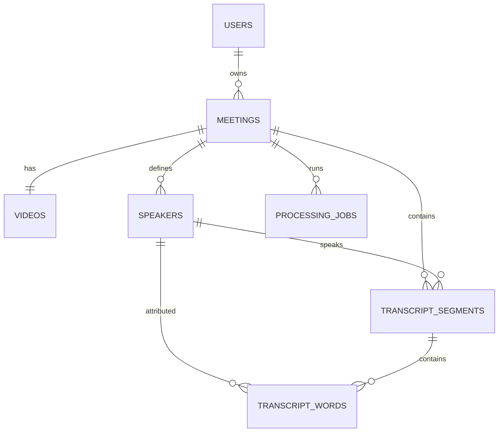

# Database Design

| Field | Value |
|---|---|
| Document ID | DBD-001 |
| Version | 0.1.0 |
| Status | Design only - not implemented |
| Last updated | 2026-11-20 |
| Database | SQLite 3 (MVP), SQLAlchemy 2.x, Alembic |
| Related documents | `SYSTEM_ARCHITECTURE.md`, `API_DESIGN.md`, `PROJECT_REQUIREMENTS.md` |

> **Implementation status:** No schema, migration, or database exists. This document defines the intended initial schema for Part 3. It will be validated by an Alembic migration and integration tests before being marked implemented.

---

## 1. Design principles

1. **Database is the lifecycle source of truth.** The filesystem stores media and artifacts; the database stores metadata, transcript text, and job state.
2. **No large media in SQLite.** Videos, WAVs, and model weights live under the storage root. The database stores relative paths and checksums.
3. **Portable IDs.** All primary keys are UUIDv4 strings generated by the application, so the schema can move to PostgreSQL later.
4. **Millisecond media times.** All transcript and duration fields are integer milliseconds. Wall-clock timestamps are ISO-8601 UTC text.
5. **Explicit state.** Statuses and stages are constrained text enums, not free-form strings.
6. **Atomic transcript replacement.** Reprocessing writes a new transcript in one transaction and never exposes a partial result.
7. **Deterministic ordering.** Unique sequence/word indexes plus stable sort rules make output reproducible.
8. **Soft delete for meetings.** User-facing deletion hides data immediately; a purge job removes files and rows asynchronously.

---

## 2. SQLite configuration and conventions

| Topic | Decision |
|---|---|
| Journal mode | WAL |
| Foreign keys | `PRAGMA foreign_keys=ON` on every connection |
| Busy timeout | 5000 ms |
| Synchronous | `NORMAL` in development; revisit for production |
| Concurrency | One writer at a time; short transactions; one worker by default |
| Migrations | Alembic with SQLite batch mode |
| Booleans | `INTEGER` with `CHECK (col IN (0,1))` |
| Enums | `TEXT` with `CHECK` constraints and matching Python/Pydantic enums |
| JSON | SQLAlchemy `JSON` stored as text; no dependency on JSON1 query features in the MVP |
| Timestamps | ISO-8601 UTC strings, app-generated; no SQLite triggers |
| IDs | UUIDv4 `TEXT(36)`; no auto-increment public IDs |
| Text | UTF-8; normalized to NFC at the application boundary where practical |

**Why SQLite:** the MVP is single-user and single-node. WAL mode plus short transactions supports concurrent reads during a worker write. If concurrent writers, multi-user access, or replication become requirements, migrate to PostgreSQL; the schema avoids SQLite-only types and features.

**Database location:** `data/meetscribe.db` (configurable). The directory is created on startup and excluded from version control.

---

## 3. Entity-relationship diagram

Notes:

- `VIDEOS` is one-to-one with `MEETINGS` in the MVP (`meeting_id` unique).
- `TRANSCRIPT_WORDS.meeting_id` is a denormalized FK to simplify purge and diagnostics; it must match the parent segment's meeting.
- `SPEAKERS` are deleted only with their meeting. Segment/word speaker references use `ON DELETE SET NULL` to avoid deleting transcript text if a speaker is removed.
- Soft-deleted meetings keep their children until purge.

---

## 4. Tables

### 4.1 `users`

| Column | Type | Null | Key / default | Constraints |
|---|---|---|---|---|
| `id` | TEXT | NO | PK | UUIDv4 |
| `email` | TEXT | NO | UNIQUE, `COLLATE NOCASE` | Valid email shape; stored lowercase |
| `display_name` | TEXT | NO | | Length 1-120 |
| `is_local` | INTEGER | NO | DEFAULT 0 | `CHECK (is_local IN (0,1))` |
| `created_at` | TEXT | NO | | ISO-8601 UTC |
| `updated_at` | TEXT | NO | | ISO-8601 UTC |

**Relationships:** one user owns many meetings. `meetings.owner_id` uses `ON DELETE RESTRICT`.

**MVP note:** authentication is not implemented. Part 3 seeds one local user (`is_local=1`) and the API uses a configured local owner ID. The table exists so multi-user support does not require a schema rewrite.

### 4.2 `meetings`

| Column | Type | Null | Key / default | Constraints |
|---|---|---|---|---|
| `id` | TEXT | NO | PK | UUIDv4 |
| `owner_id` | TEXT | NO | FK -> `users.id` | `ON DELETE RESTRICT` |
| `title` | TEXT | NO | | `length(title) BETWEEN 1 AND 200` |
| `description` | TEXT | YES | | Max 2000 characters (application-level) |
| `status` | TEXT | NO | DEFAULT `'queued'` | `CHECK (status IN ('queued','processing','completed','failed','deleted'))` |
| `language` | TEXT | YES | | ISO 639-1/BCP-47 code, detected or hinted |
| `duration_ms` | INTEGER | YES | | `CHECK (duration_ms IS NULL OR duration_ms >= 0)` |
| `speaker_count` | INTEGER | YES | | `CHECK (speaker_count IS NULL OR speaker_count >= 0)` |
| `alignment_quality` | TEXT | YES | | `CHECK (alignment_quality IN ('word','estimated_word','segment_only'))` |
| `diarization_status` | TEXT | YES | | `CHECK (diarization_status IN ('completed','degraded_single_speaker','failed'))` |
| `warning_code` | TEXT | YES | | Stable warning code |
| `quality_flags` | TEXT | NO | DEFAULT `'[]'` | JSON array of warning codes |
| `error_code` | TEXT | YES | | Stable error code; cleared on retry |
| `error_message` | TEXT | YES | | User-safe message; no stack traces |
| `created_at` | TEXT | NO | | ISO-8601 UTC |
| `updated_at` | TEXT | NO | | ISO-8601 UTC |
| `completed_at` | TEXT | YES | | Set when status becomes `completed` |
| `deleted_at` | TEXT | YES | | Set when soft-deleted |

**Constraints**

- `CHECK ((deleted_at IS NULL AND status <> 'deleted') OR (deleted_at IS NOT NULL AND status = 'deleted'))`
- `CHECK (status <> 'completed' OR completed_at IS NOT NULL)`

**Indexes**

- `ix_meetings_owner_created (owner_id, created_at DESC)`
- `ix_meetings_status (status)`
- `ix_meetings_deleted_at (deleted_at)`

**Relationships:** many meetings per user; one video; many speakers, segments, jobs; segments contain words.

**Derived fields:** `duration_ms` and `speaker_count` are caches for list rendering. The canonical values remain in `videos` and `speakers`.

### 4.3 `videos`

| Column | Type | Null | Key / default | Constraints |
|---|---|---|---|---|
| `id` | TEXT | NO | PK | UUIDv4 |
| `meeting_id` | TEXT | NO | FK -> `meetings.id`, UNIQUE | `ON DELETE CASCADE` |
| `storage_path` | TEXT | NO | | Relative path under storage root; server-generated |
| `original_filename` | TEXT | NO | | Sanitized display only; never used as a path |
| `declared_mime_type` | TEXT | YES | | Untrusted client value, retained for diagnostics |
| `detected_container` | TEXT | YES | | FFprobe format name |
| `size_bytes` | INTEGER | NO | | `CHECK (size_bytes > 0)` |
| `sha256` | TEXT | NO | | `CHECK (length(sha256) = 64)` |
| `duration_ms` | INTEGER | NO | | `CHECK (duration_ms >= 0)` |
| `width` | INTEGER | YES | | `CHECK (width IS NULL OR width > 0)` |
| `height` | INTEGER | YES | | `CHECK (height IS NULL OR height > 0)` |
| `video_codec` | TEXT | YES | | FFprobe codec name |
| `audio_codec` | TEXT | YES | | FFprobe codec name |
| `audio_sample_rate` | INTEGER | YES | | `CHECK (audio_sample_rate IS NULL OR audio_sample_rate > 0)` |
| `audio_channels` | INTEGER | YES | | `CHECK (audio_channels IS NULL OR audio_channels > 0)` |
| `audio_stream_index` | INTEGER | YES | | `CHECK (audio_stream_index IS NULL OR audio_stream_index >= 0)` |
| `audio_offset_ms` | INTEGER | NO | DEFAULT 0 | Signed audio-to-presentation offset; see pipeline section 6 |
| `is_browser_playable` | INTEGER | NO | DEFAULT 0 | `CHECK (is_browser_playable IN (0,1))` |
| `audio_path` | TEXT | YES | | Relative WAV path; nullable until extraction |
| `audio_duration_ms` | INTEGER | YES | | `CHECK (audio_duration_ms IS NULL OR audio_duration_ms >= 0)` |
| `created_at` | TEXT | NO | | ISO-8601 UTC |

**Indexes:** `ix_videos_sha256 (sha256)` for duplicate diagnostics.

**Relationships:** one video per meeting. `audio_path` is nullable so an uploaded-but-not-processed meeting can be represented.

### 4.4 `speakers`

| Column | Type | Null | Key / default | Constraints |
|---|---|---|---|---|
| `id` | TEXT | NO | PK | UUIDv4 |
| `meeting_id` | TEXT | NO | FK -> `meetings.id` | `ON DELETE CASCADE` |
| `ordinal` | INTEGER | NO | | `CHECK (ordinal >= 1)`; `UNIQUE (meeting_id, ordinal)` |
| `display_label` | TEXT | NO | | `CHECK (length(display_label) BETWEEN 1 AND 40)`; `UNIQUE (meeting_id, display_label)` |
| `raw_label` | TEXT | YES | | Engine label (internal, never exposed); unique per meeting where present |
| `total_speech_ms` | INTEGER | NO | DEFAULT 0 | `CHECK (total_speech_ms >= 0)` |
| `created_at` | TEXT | NO | | ISO-8601 UTC |

**Indexes**

- `ux_speakers_meeting_ordinal (meeting_id, ordinal)` unique
- `ux_speakers_meeting_raw (meeting_id, raw_label) WHERE raw_label IS NOT NULL` unique
- `ix_speakers_meeting (meeting_id)`

**Rules:** labels are `Speaker 1..N`; ordering is first attributed speech, then total speech duration descending, then raw label ascending. Speakers with zero attributed words are not persisted.

### 4.5 `transcript_segments`

| Column | Type | Null | Key / default | Constraints |
|---|---|---|---|---|
| `id` | TEXT | NO | PK | UUIDv4 |
| `meeting_id` | TEXT | NO | FK -> `meetings.id` | `ON DELETE CASCADE` |
| `speaker_id` | TEXT | YES | FK -> `speakers.id` | `ON DELETE SET NULL` |
| `sequence_index` | INTEGER | NO | | `CHECK (sequence_index >= 0)`; `UNIQUE (meeting_id, sequence_index)` |
| `start_ms` | INTEGER | NO | | `CHECK (start_ms >= 0)` |
| `end_ms` | INTEGER | NO | | `CHECK (end_ms >= start_ms)` |
| `text` | TEXT | NO | | Display text, may be empty only if all tokens unaligned |
| `is_overlap` | INTEGER | NO | DEFAULT 0 | `CHECK (is_overlap IN (0,1))`; best-effort flag |
| `created_at` | TEXT | NO | | ISO-8601 UTC |

**Indexes**

- `ux_segments_meeting_sequence (meeting_id, sequence_index)` unique
- `ix_segments_meeting_start (meeting_id, start_ms)`
- `ix_segments_speaker (speaker_id)`

**Note:** Database constraints do not enforce that `end_ms <= meeting.duration_ms` because that is a cross-table invariant; the application validates it before insert.

### 4.6 `transcript_words`

| Column | Type | Null | Key / default | Constraints |
|---|---|---|---|---|
| `id` | TEXT | NO | PK | UUIDv4 |
| `meeting_id` | TEXT | NO | FK -> `meetings.id` | `ON DELETE CASCADE` |
| `segment_id` | TEXT | NO | FK -> `transcript_segments.id` | `ON DELETE CASCADE` |
| `speaker_id` | TEXT | YES | FK -> `speakers.id` | `ON DELETE SET NULL` |
| `word_index` | INTEGER | NO | | `CHECK (word_index >= 0)`; `UNIQUE (segment_id, word_index)` |
| `text` | TEXT | NO | | Token text including punctuation; length 1-200 |
| `start_ms` | INTEGER | YES | | `CHECK (start_ms IS NULL OR start_ms >= 0)` |
| `end_ms` | INTEGER | YES | | `CHECK (end_ms IS NULL OR (start_ms IS NOT NULL AND end_ms >= start_ms))` |
| `timing_source` | TEXT | NO | | `CHECK (timing_source IN ('aligned','asr_word','segment_only'))` |
| `is_overlap` | INTEGER | NO | DEFAULT 0 | `CHECK (is_overlap IN (0,1))` |
| `created_at` | TEXT | NO | | ISO-8601 UTC |

**Indexes**

- `ux_words_segment_index (segment_id, word_index)` unique
- `ix_words_meeting_start (meeting_id, start_ms)`
- `ix_words_speaker (speaker_id)`

**Semantics**

- `aligned`: forced-alignment word boundaries.
- `asr_word`: faster-whisper word timestamps (estimated/DTW).
- `segment_only`: no reliable word time; `start_ms`/`end_ms` are `NULL`, and the UI uses the parent segment's times.
- `UNKNOWN` speaker maps to `speaker_id = NULL`; it is not a separate speaker row.
- Overlap flags are only set when the engine exposes overlapping turns.

### 4.7 `processing_jobs`

| Column | Type | Null | Key / default | Constraints |
|---|---|---|---|---|
| `id` | TEXT | NO | PK | UUIDv4 |
| `meeting_id` | TEXT | NO | FK -> `meetings.id` | `ON DELETE CASCADE` |
| `job_type` | TEXT | NO | DEFAULT `'process'` | `CHECK (job_type IN ('process','reprocess','purge'))` |
| `status` | TEXT | NO | DEFAULT `'queued'` | `CHECK (status IN ('queued','running','succeeded','failed','canceled'))` |
| `stage` | TEXT | NO | DEFAULT `'received'` | `CHECK (stage IN ('received','validate','probe','extract_audio','preprocess','transcribe','diarize','align','assemble','order','persist','cleanup','done'))` |
| `progress_pct` | INTEGER | NO | DEFAULT 0 | `CHECK (progress_pct BETWEEN 0 AND 100)` |
| `attempts` | INTEGER | NO | DEFAULT 0 | `CHECK (attempts >= 0)`; increment on claim |
| `max_attempts` | INTEGER | NO | DEFAULT 3 | `CHECK (max_attempts BETWEEN 1 AND 10)`; `CHECK (attempts <= max_attempts)` |
| `worker_id` | TEXT | YES | | Lease owner |
| `locked_at` | TEXT | YES | | Claim time |
| `heartbeat_at` | TEXT | YES | | Updated while running |
| `started_at` | TEXT | YES | | First claim/start |
| `finished_at` | TEXT | YES | | Set for terminal statuses |
| `error_code` | TEXT | YES | | Stable code |
| `error_message` | TEXT | YES | | User-safe message |
| `result_summary` | TEXT | YES | | JSON: counts, warnings, timings |
| `config_hash` | TEXT | YES | | Hash of model/config for artifact reuse |
| `created_at` | TEXT | NO | | ISO-8601 UTC |
| `updated_at` | TEXT | NO | | ISO-8601 UTC |

**Indexes**

- `ux_jobs_active_meeting (meeting_id) WHERE status IN ('queued','running')` unique (partial index)
- `ix_jobs_status_created (status, created_at)`
- `ix_jobs_meeting_created (meeting_id, created_at)`
- `ix_jobs_heartbeat (status, heartbeat_at)`

**Job rules**

- `attempts` increments when a worker claims the job, while `attempts < max_attempts`.
- A running job whose `heartbeat_at` is older than the lease timeout (default 120 s) is reclaimable. If `attempts >= max_attempts`, reclamation marks it `failed` with `JOB_TIMEOUT`/`WORKER_LOST` instead of incrementing.
- Terminal states require `finished_at`.
- Retry policy: new attempt on the same row until `attempts = max_attempts`; then `failed`.
- A reprocess request creates a new job row rather than resetting a terminal one.
- Delete flow: mark meeting `deleted`, cancel any active job, then enqueue a `purge` job. The partial unique index enforces at most one active job per meeting.

### 4.8 Optional `processing_events` (deferred)

An append-only event log (job ID, timestamp, level, stage, code, message, JSON payload) is useful for observability but is not required for the MVP schema. It can be added in Part 14/15 without changing the core tables. Until then, structured logs and `run.json` artifacts provide diagnostics.

---

## 5. Delete and retention behavior

### Soft delete

1. `DELETE /api/v1/meetings/{id}` sets `status='deleted'`, `deleted_at`, and cancels active jobs in one transaction.
2. Lists and detail queries exclude `deleted_at IS NOT NULL`; video streaming returns `410 Gone`.
3. A `purge` job removes storage files and hard-deletes the meeting row; cascades remove children.
4. If purge fails, the database remains consistent (soft-deleted), and a startup/periodic sweep can retry. Disk space is not reclaimed until purge succeeds.

### Retention

| Data | Retention (MVP default) |
|---|---|
| Original video | Until meeting purge |
| Audio/artifacts | Until meeting purge; regenerable |
| Transcript rows | Until meeting purge |
| Job rows | 30 days after terminal state (proposed; confirm) |
| Logs | 30 days (proposed; confirm) |
| Model cache | Persistent; independent of meetings |

Retention periods are configuration values, not hard-coded guarantees. They must be confirmed before the academic submission.

---

## 6. Data volume estimates

| Item | Estimate |
|---|---|
| 1-hour meeting transcript | ~8,000-10,000 words, ~500-1,200 segments |
| 4-hour meeting transcript | ~32,000-40,000 words, ~2,000-5,000 segments |
| WAV at 16 kHz mono 16-bit | 32 kB/s -> ~115 MB/hour; ~460 MB for 4 hours |
| SQLite transcript rows | Tens of MB at most for 4 hours |
| Original video | Up to 2 GiB by default (external to DB) |
| Artifacts | Tens of MB per job |

The schema is well within SQLite's capacity for the MVP. Performance risk is dominated by media processing, not database size.

---

## 7. Access patterns and indexes

| Use case | Query shape | Index |
|---|---|---|
| Meeting library | Filter owner, not deleted, order by created_at desc | `ix_meetings_owner_created`, `ix_meetings_deleted_at` |
| Status polling | Fetch meeting + active job by meeting ID | Primary keys + partial unique job index |
| Transcript load | Segments by meeting ordered by sequence; words by segment | `ux_segments_meeting_sequence`, `ux_words_segment_index` |
| Active segment (client) | In-memory binary search over loaded segments | No per-segment query |
| Speakers | By meeting ordered by ordinal | unique index |
| Worker claim | Oldest queued job | `ix_jobs_status_created` |
| Stale lease sweep | Running jobs by heartbeat | `ix_jobs_heartbeat` |
| Delete purge | Children by meeting | FKs + meeting indexes |
| Duplicate diagnostics | By SHA-256 | `ix_videos_sha256` |

Avoid N+1 queries: load segments and words in two batched queries (or a joined select) and group in memory.

---

## 8. Integrity rules beyond database constraints

The application must validate before commit:

1. `segment.end_ms <= meeting.duration_ms` (allow a small tolerance only if documented).
2. Every word's segment belongs to the same meeting.
3. Word times, when present, are within their segment's `[start_ms, end_ms]` (with a configurable tolerance for alignment edge effects).
4. `sequence_index` is contiguous from 0 for a completed transcript.
5. `word_index` is contiguous from 0 within each segment.
6. Speaker `ordinal` values are contiguous from 1 and unique per meeting.
7. `timing_source='segment_only'` implies null word times.
8. `status='completed'` implies at least a video row and a committed transcript (empty transcripts are allowed with a warning).
9. `status='deleted'` implies `deleted_at` is set and no active processing job exists.
10. No raw engine speaker label is exposed by the API.

---

## 9. Migration and seeding policy

- Alembic is the only mechanism for schema changes; no `create_all()` in production paths.
- Use SQLite batch mode for ALTER operations.
- The initial migration creates all tables, checks, indexes, and the partial unique index.
- Seed one local user with a fixed, documented UUID for the single-user MVP.
- Migration tests run against a temporary database and must verify upgrade from empty and downgrade to empty (where safe).
- Back up `data/meetscribe.db` before applying migrations in demonstration environments.
- The schema version is recorded in the Alembic version table and reported by the health endpoint.

---

## 10. Open database decisions

| ID | Decision | Status |
|---|---|---|
| DB-OQ-01 | Exact retention period for job rows and artifacts | Unresolved |
| DB-OQ-02 | Whether to add `processing_events` in Part 14 or use log files only | Unresolved |
| DB-OQ-03 | Whether purge is automatic or manual after soft delete | Unresolved |
| DB-OQ-04 | Whether multi-user auth is required before the academic demo | Unresolved |
| DB-OQ-05 | PostgreSQL migration timing (not MVP) | Deferred |
