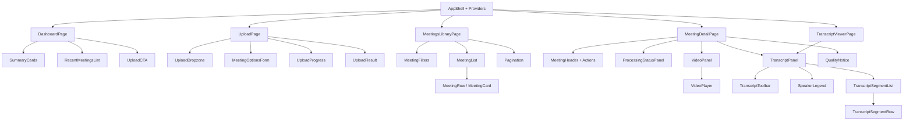

# Frontend Architecture

| Field | Value |
|---|---|
| Document ID | FEA-001 |
| Version | 0.1.0 |
| Status | Design only - not implemented |
| Last updated | 2026-11-20 |
| Stack | Next.js App Router, React, TypeScript, Tailwind CSS, HTML5 video |
| Related documents | `API_DESIGN.md`, `PROJECT_REQUIREMENTS.md`, `SYSTEM_ARCHITECTURE.md` |

> **Implementation status:** No frontend exists. This document defines pages, components, state, synchronization behavior, and testing for Parts 11-13.

---

## 1. Frontend principles

1. **Server state is not duplicated.** TanStack Query owns meetings, status, transcripts, and speakers.
2. **The video element is the clock.** Transcript highlighting is derived from `video.currentTime`, not from wall-clock timers.
3. **No frame-by-frame React re-renders.** A small external player store updates the time; only the active segment ID triggers visible list changes.
4. **Honest states.** Processing, failure, degraded diarization, and estimated timestamps are visible, not hidden.
5. **Accessible interactions.** Timestamps are buttons; the active segment is announced semantically; keyboard users can seek.
6. **Progressive enhancement.** The viewer works with segment-level timing even when word-level alignment is unavailable.

---

## 2. Routes and pages

| Route | Page | Purpose | Rendering |
|---|---|---|---|
| `/` | Dashboard | Overview, recent meetings, upload CTA | Server shell + client queries |
| `/upload` | Upload Meeting | Select file, metadata, progress, submit | Client |
| `/meetings` | Meetings Library | List/filter/paginate, status, delete | Client queries |
| `/meetings/[id]` | Meeting Detail | Player + transcript + status + actions | Client detail with server shell |
| `/meetings/[id]/transcript` | Transcript Viewer | Focused, full-height transcript reader | Client |

### 2.1 Dashboard

- Summary cards: total meetings, completed, processing, failed (from a lightweight list or future stats endpoint).
- Recent meetings (5) with status badges and links.
- Primary "Upload meeting" call to action.
- Empty state for a new installation.
- No fabricated analytics; counts come from API responses. If a stats endpoint is not built, derive counts only from the loaded page and label them accordingly, or defer the cards.

### 2.2 Upload Meeting

- Drag-and-drop zone plus file picker; one file.
- Accepted formats shown from `/capabilities` when available; static fallback text otherwise.
- Client-side checks (extension, size) are UX only; server validation is authoritative.
- Optional title (default filename stem), language hint, min/max speaker hints.
- Upload progress bar driven by XHR `upload.onprogress`.
- Submission states: idle, validating, uploading, creating job, success, error.
- On success: show meeting link and navigate to detail, or offer both.
- Errors map from the API envelope to actionable messages; never display raw stack traces.

### 2.3 Meetings Library

- Card/table list with title, duration, created date, status badge, speaker count (if completed).
- Filters: status; search by title; pagination.
- Actions: open, delete (confirmation), retry for failed items.
- Poll only rows currently `queued`/`processing`? Prefer a single page-level status query per active meeting, capped to avoid N+1 polling. MVP: refresh list every 5 s while any visible meeting is active.
- Delete confirmation explains that disk cleanup is asynchronous.

### 2.4 Meeting Detail

Layout (desktop >= 1024 px):

```text
+---------------------------------------------------------------+
| Header: title, status badge, duration, actions (retry/delete) |
+-------------------------------+-------------------------------+
| Video player (sticky)         | Transcript toolbar            |
|                               | Speaker legend                |
|                               | Scrollable transcript         |
|                               |  [00:00:04] Speaker 1 ...     |
+-------------------------------+-------------------------------+
```

- On narrow screens, stack video above transcript.
- While processing: show stage, progress, attempts, and a clear notice; do not show a fake transcript.
- On failure: show safe error, retry button, and job history link/details.
- On completion: load transcript and speakers in parallel, then enable sync.
- Quality notices: degraded diarization, estimated/segment-only alignment, empty transcript, warnings.
- The file name and checksum may be shown in a details panel; filesystem paths must not be shown.

### 2.5 Transcript Viewer

- Full-height transcript without the player, for reading and export.
- Reuses `TranscriptPanel` in `readOnly` mode; no active highlighting.
- Link back to Meeting Detail.
- Useful for printing/copying; export buttons call the transcript API with `format=srt|vtt|txt`.
- Optional future: deep links `?t=4000` to open the detail player at a timestamp.

---

## 3. Component hierarchy



### 3.1 Component responsibilities

| Component | Responsibility |
|---|---|
| `AppShell` | Layout, header, navigation, providers, global error boundary. |
| `Providers` | TanStack Query client, player store context, toast region. |
| `SummaryCards` | Render counts derived from available data; no invented metrics. |
| `UploadDropzone` | File selection/drag-drop, client hints, keyboard accessibility. |
| `MeetingOptionsForm` | Title, language, speaker hints; validation messages. |
| `UploadProgress` | Byte-based progress, cancel (if implemented), retry guidance. |
| `MeetingFilters` | Status/search controls synchronized with URL query params. |
| `MeetingList` / `MeetingRow` | Status badges, metadata, actions, accessible links. |
| `MeetingHeader` | Title, duration, status, rename/delete/retry. |
| `ProcessingStatusPanel` | Stage/progress/attempts; polls via the status query. |
| `VideoPlayer` | Native `<video controls>`; ref registration; error/loading UI. |
| `TranscriptToolbar` | Follow toggle, export menu, segment count, quality badge. |
| `SpeakerLegend` | Speaker labels and optional colors. |
| `TranscriptPanel` | Scroll container, active segment subscription, auto-scroll policy. |
| `TranscriptSegmentList` | Virtualized list when needed; stable keys. |
| `TranscriptSegmentRow` | Timestamp button, speaker label, text, active state, overlap/quality tags. |
| `QualityNotice` | Degraded diarization/alignment/empty transcript messaging. |

---

## 4. State management

### 4.1 Server state (TanStack Query)

| Query key | Fetch | Notes |
|---|---|---|
| `["meetings", filters]` | `GET /meetings` | Keep previous page while fetching. |
| `["meeting", id]` | `GET /meetings/{id}` | Detail metadata and video. |
| `["meeting-status", id]` | `GET /meetings/{id}/status` | Poll while active. |
| `["transcript", id, includeWords]` | `GET /meetings/{id}/transcript` | Disabled until completed. |
| `["speakers", id]` | `GET /meetings/{id}/speakers` | Can be derived from transcript; fetch for legend parity. |
| `["jobs", id]` | `GET /meetings/{id}/jobs` | On-demand diagnostics. |
| `["capabilities"]` | `GET /capabilities` | Long stale time (5 min). |

Rules:

- Poll status every 2 s while `queued`/`processing`; stop on terminal states.
- When status becomes `completed`, invalidate `meeting`, `transcript`, `speakers`, and `meetings`.
- On upload/retry/delete, invalidate the affected queries.
- Do not cache transcripts in localStorage; they contain private meeting content.
- Set `refetchOnWindowFocus` deliberately (recommended: true for status, false for transcript).

### 4.2 UI state

- **URL state:** library filters, pagination, and optional `?t=` timestamp deep link.
- **Upload state:** local component state (`idle | uploading | submitting | success | error`) plus progress percentage.
- **Player state:** external store (section 5), not TanStack Query.
- **Follow/auto-scroll:** player store + persisted preference (optional localStorage).
- **Dialogs:** local state for delete confirmation/export menu.
- No Redux. A global store is unnecessary for this scope.

### 4.3 Why an external player store

`currentTime` changes several times per second. Storing it in React state at the page level re-renders the entire transcript. Instead:

- A small `PlayerStore` holds `currentTimeMs`, `durationMs`, `isPlaying`, `activeSegmentId`, `followEnabled`, and `error`.
- Components subscribe with selectors via `useSyncExternalStore`.
- The segment list subscribes to `activeSegmentId` only; it re-renders when the active segment changes, not every tick.
- A progress indicator can subscribe to a throttled `currentTimeMs`.
- The store is created per Meeting Detail page and disposed on unmount.

---

## 5. Video playback state and synchronization

### 5.1 Player state machine

```text
idle -> loading -> ready -> playing <-> paused -> ended
                    |          |
                    +-> error <-+
```

- `loading`: metadata not yet available.
- `ready`: `loadedmetadata` fired; duration known.
- `playing`: `play` event; rAF loop active.
- `paused`: `pause` event; loop stopped, one final highlight sync.
- `ended`: `ended` event; active segment cleared or last segment retained (choose: clear).
- `error`: `error` event or unsupported source; show message and retry.

### 5.2 Time tracking

- On `loadedmetadata`, set `durationMs` and sync once.
- On `play`, start a `requestAnimationFrame` loop.
- On `pause`/`ended`/unmount, cancel the loop.
- On `seeking`/`seeked`, sync immediately.
- Fallback: listen to `timeupdate` (about 4 Hz) for browsers where rAF is throttled in background tabs.
- Throttle store updates to at most 10 Hz (`>=100 ms` change) to reduce renders. The active segment boundary is still detected within ~100 ms, which is below the segment tolerance target.
- Clamp times to `[0, durationMs]`.

### 5.3 Active segment selection

Segments are sorted by `sequence_index`/`start_ms`. Use binary search for the last segment with `start_ms <= time`:

```text
index = upperBound(segments.start_ms, timeMs) - 1
if index >= 0 and timeMs < segments[index].end_ms: active = segments[index]
else: active = null
```

- `start_ms` is inclusive; `end_ms` is exclusive.
- During silence gaps, no segment is active. Keep the last segment visually deselected; do not falsely highlight.
- If word-level timing exists, a future enhancement can highlight the current word using the same rule; the MVP highlights segments.
- On seek, compute immediately from the target time before `seeked` fires (`pendingSeekMs`) to avoid a stale highlight.

### 5.4 Timestamp click handling

```text
onTimestampClick(segment):
  target = segment.start_ms / 1000 + 0.001   // avoid landing exactly at the previous boundary
  video.currentTime = clamp(target, 0, duration)
  store.setActiveSegment(segment.id)
  store.setPendingSeek(null)
  if store.followEnabled: scroll segment into view
  preserve play/pause state (do not force play)
```

- The timestamp is a `<button>` with an accessible label (`Seek to 00:04`).
- If the video is not ready, queue the seek and apply it on `loadedmetadata`.
- If the target exceeds duration, clamp and show a non-blocking message.
- Clicking the already-active timestamp still seeks to its start (useful for replay).

### 5.5 Auto-scroll and Follow

- Default `followEnabled = true`.
- When the active segment changes and Follow is enabled, scroll it to the center of the transcript container.
- Detect user-initiated scroll (wheel, touch, keyboard PageUp/PageDown) and set `followEnabled=false`; show a "Follow" button.
- Programmatic scroll must not disable Follow; use a flag/timestamp to distinguish.
- Respect `prefers-reduced-motion`: use `behavior: "auto"` when reduced motion is requested.
- Do not auto-scroll while the user is selecting text.

### 5.6 Seek accuracy

- `video.currentTime` is media-relative; the API already stores media-relative milliseconds.
- Never add the audio offset in the frontend.
- Seeking to a segment start should highlight that segment even if the browser lands a few milliseconds early; the 1 ms guard plus inclusive start handles this.
- Test with segment boundaries and silence gaps.

---

## 6. API communication

### 6.1 Client

- `lib/api/client.ts`: base URL from `NEXT_PUBLIC_API_BASE_URL`, JSON parsing, error envelope parsing, request ID exposure, abort support.
- `lib/api/meetings.ts`: typed functions for each endpoint.
- `lib/api/upload.ts`: XHR-based upload with progress; fetch is used elsewhere.
- Types: generate from OpenAPI when practical; otherwise a hand-written `types/api.ts` mirrored by contract tests. Do not use `any` for API payloads.

### 6.2 Error handling

- Parse `{ error: { code, message, details, request_id } }`.
- Show `message` to the user; log `code`/`request_id` for support.
- Map known codes to specific guidance:
  - `FILE_TOO_LARGE`: show configured limit.
  - `UNSUPPORTED_FORMAT`: list accepted formats.
  - `NO_AUDIO_STREAM`: explain that the recording has no audio.
  - `MEETING_PROCESSING`: show the status panel instead of an error toast.
  - `MEETING_DELETED`: navigate to the library with a notice.
- Network failures: retry with backoff for idempotent GETs; do not auto-retry uploads.

### 6.3 Upload

- Use XHR for reliable progress events; `fetch` upload progress is not universally supported.
- Send `multipart/form-data` with `file`, optional `title`, `language`, `min_speakers`, `max_speakers`.
- Disable submit while uploading; allow cancel in a future iteration.
- On success, invalidate the meetings list and navigate to the new meeting.
- Validate hints client-side for UX, but rely on server errors for authority.

### 6.4 Polling

- Status query `refetchInterval` function: 2000 ms while `queued`/`processing`, otherwise `false`.
- Use `refetchIntervalInBackground: false`.
- Add jitter or a fixed 2 s interval; do not poll faster than 1 Hz.
- On repeated status failures, back off and show a "connection issue" notice.
- Stop polling when the page is hidden; resume on visibility change (TanStack Query default behavior can be configured).

---

## 7. Styling and design system

- Tailwind CSS utility classes with a small set of design tokens (colors, spacing, radii) in the Tailwind config.
- Status badges: queued (neutral), processing (animated but reduced-motion aware), completed (success), failed (danger), deleted (hidden).
- Speaker colors: deterministic palette by ordinal; always pair color with a text label (never color-only).
- Typography: readable transcript line length (about 60-80 characters), generous line height.
- Layout: CSS grid for the two-pane detail page; sticky player on desktop; single column on mobile.
- Dark mode is optional; if implemented, verify contrast for speaker colors and badges.
- No component library is required; use accessible primitives and Tailwind. If a library is added, verify bundle size and licensing.

---

## 8. Accessibility

- Semantic landmarks: `header`, `main`, `nav`, `section` with accessible names.
- Timestamp buttons: `aria-label="Seek to 00:04"`, visible focus ring.
- Active segment: `aria-current="true"` and a visible non-color-only indicator.
- Transcript list: `<ol>` with one `<li>` per segment; speaker labels are text, not icon-only.
- Video: native controls retained; provide a text alternative/transcript link.
- Keyboard: Tab to timestamps, Enter/Space to seek; do not trap focus in the transcript.
- Announce processing status changes with a polite live region.
- Respect reduced motion for auto-scroll and badge animation.
- Target WCAG 2.1 AA contrast and focus visibility for core flows.
- Do not auto-play audio; browser autoplay policies and user expectations forbid it.

---

## 9. Loading, empty, and error states

| State | UI |
|---|---|
| Library empty | Explain upload, show CTA. |
| Library loading | Skeletons, not a blank page. |
| Meeting queued | Status panel with "Waiting for worker", progress 0. |
| Meeting processing | Stage label, progress, attempts, cancel/delete guidance; no transcript. |
| Meeting failed | Safe message, retry, job details; original file retained. |
| Transcript empty | "No speech detected" with warning; do not show a fake transcript. |
| Diarization degraded | Banner: "Speaker separation unavailable; all speech is labeled Speaker 1." |
| Alignment estimated | Badge: "Word timestamps are estimated" or "Segment-level timing only." |
| Video unsupported | Explain codec issue and offer transcript-only reading. |
| Deleted | Navigate away with a notice; stream returns 410. |
| API offline | Retry/backoff notice; do not lose the current transcript view unnecessarily. |

---

## 10. Performance

- Virtualize the transcript when segment count exceeds ~500 (`@tanstack/react-virtual` is a candidate; decide in Part 13). Do not virtualize before measuring.
- Memoize `TranscriptSegmentRow`; pass stable props; avoid inline callbacks per row where it causes re-renders.
- Subscribe to `activeSegmentId` rather than `currentTimeMs` for the list.
- Keep transcript data in memory only; no localStorage for private content.
- Use `next/dynamic` for heavy, below-the-fold components if needed; avoid over-splitting the core viewer.
- Avoid loading word-level data unless the feature is enabled.
- Use HTTP Range streaming; never fetch the entire video into a blob.
- Measure with React Profiler and browser performance tools before optimizing.

---

## 11. Frontend testing

| Level | Tools (to be confirmed) | Coverage |
|---|---|---|
| Unit | Vitest | Time formatting, binary search, active-segment boundaries, seek target clamping. |
| Component | Vitest + React Testing Library + MSW | Timestamp click, highlight changes, Follow toggle, error states. |
| Integration | MSW + test page | Upload flow, polling transitions, transcript load, delete. |
| E2E | Playwright | Real browser video seeking, Range playback, click-to-seek, highlight, degraded states. |
| Accessibility | axe or Lighthouse | Landmarks, labels, contrast, keyboard flow. |

Test the synchronization logic as pure functions before wiring it to the DOM. Mock `HTMLMediaElement` behavior carefully; fake timers alone cannot validate real seeking. Use a small test video fixture for E2E.

---

## 12. Frontend directory layout (proposed)

```text
frontend/
  src/
    app/
      layout.tsx
      page.tsx                      # Dashboard
      upload/page.tsx
      meetings/page.tsx
      meetings/[id]/page.tsx
      meetings/[id]/transcript/page.tsx
      globals.css
    components/
      layout/
      ui/
      meetings/
      upload/
      transcript/
      player/
    features/
      meetings/
        api.ts
        queries.ts
        types.ts
    lib/
      api/client.ts
      api/errors.ts
      player/store.ts
      player/selectors.ts
      format/time.ts
      config.ts
    hooks/
    types/
  public/
  tests/
    unit/
    component/
    e2e/
  tailwind.config.ts
  next.config.ts
  tsconfig.json
  package.json
```

Features are grouped by domain; shared UI primitives stay in `components/ui`. The player store and time utilities are isolated so they can be unit-tested without React.

---

## 13. Open frontend decisions

| ID | Decision | Status |
|---|---|---|
| FE-OQ-01 | Use a same-origin Next.js rewrite/proxy or direct browser-to-FastAPI calls with CORS? | Unresolved (recommend direct API for uploads, rewrite optional for reads) |
| FE-OQ-02 | Virtualize transcript from the start or after measurement? | Unresolved (measure first) |
| FE-OQ-03 | Component library vs. custom Tailwind primitives? | Recommended: custom primitives |
| FE-OQ-04 | Persist Follow preference? | Optional |
| FE-OQ-05 | Add word-level highlighting in the MVP or defer? | Deferred; segment highlighting is the MVP |
| FE-OQ-06 | Deep-link format (`?t=4000`) and sharing behavior? | Future |
