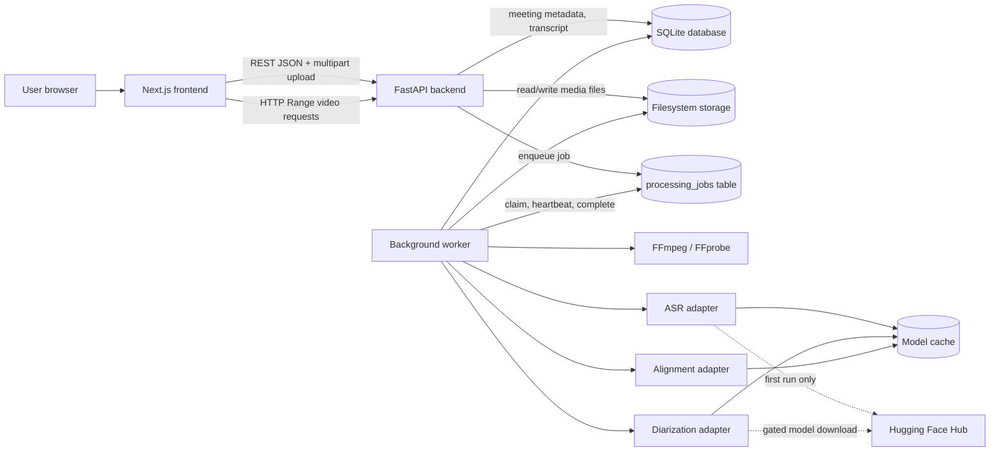
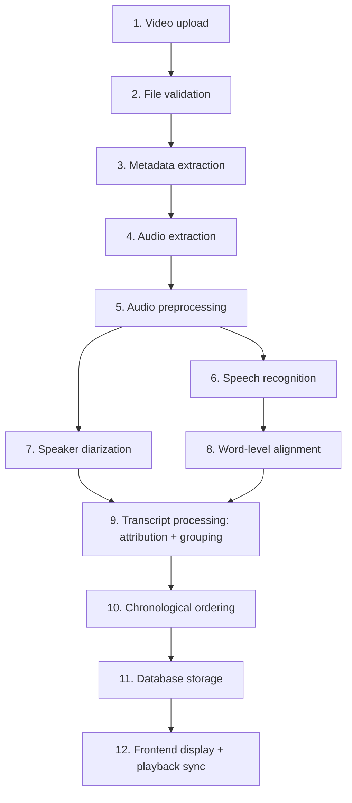
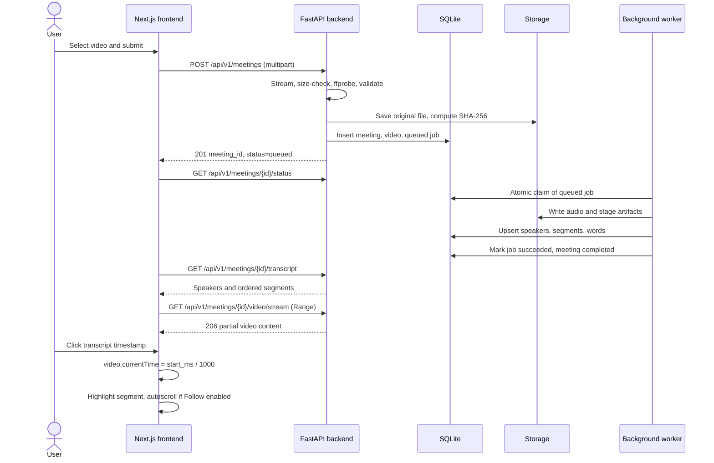
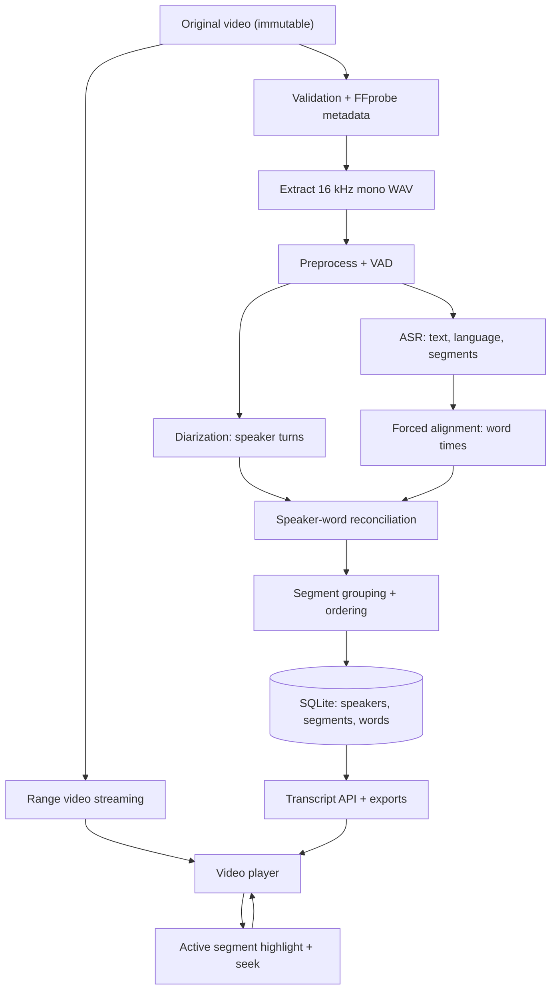
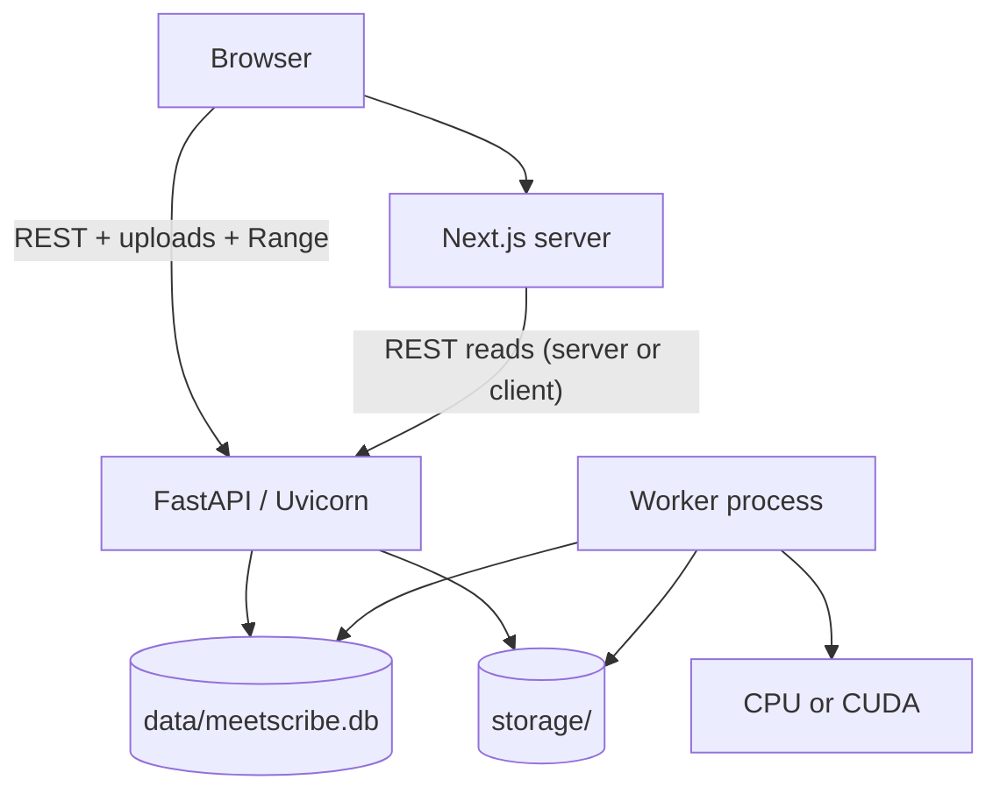

# System Architecture

| Field | Value |
|---|---|
| Document ID | SAD-001 |
| Version | 0.1.0 |
| Status | Draft for team review - Part 1 |
| Last updated | 2026-11-20 |
| Scope | Modular monolith architecture; no implementation |

> **Implementation status:** This is a design document. No frontend, backend, worker, database, or AI pipeline has been implemented.

---

## 1. Architectural goals

1. **Modular monolith:** one deployable backend, one worker process, one frontend, one database. No microservices, service mesh, message broker, or Kubernetes in the MVP.
2. **Replaceable AI components:** ASR, diarization, and alignment sit behind explicit ports/adapters. Upgrading or replacing a model must not require rewriting the API, database, or UI.
3. **Long-running work never blocks HTTP requests:** transcription and diarization run in a separate worker process.
4. **Durable processing:** jobs survive API restarts, worker crashes, and browser disconnects. Intermediate artifacts allow resume without repeating expensive stages.
5. **Correct timeline semantics:** audio-relative timestamps are converted to media-relative timestamps exactly once, at a documented boundary.
6. **Honest quality semantics:** alignment quality and diarization degradation are explicit fields, not hidden assumptions.
7. **Local-first privacy:** no third-party inference API in the MVP. Network access is only for one-time model downloads.

### Non-goals

Microservices, Kubernetes, event streaming, multi-region deployment, real-time transcription, horizontal GPU scheduling, and multi-tenant isolation are out of scope for the MVP.

---

## 2. High-level system architecture



The browser talks to the API over REST. Uploads use multipart; video playback uses HTTP Range requests. The API writes metadata and job rows to SQLite and media to the filesystem. A separate worker claims queued jobs and runs the AI pipeline. Model weights are cached locally after the first download.

### 2.1 Why a separate worker

FastAPI request handlers must stay responsive and must not hold GPU/CPU-heavy models in the web process. The worker is a long-lived Python process in the same codebase. It polls the `processing_jobs` table, claims a job atomically, updates heartbeats, and writes stage artifacts. This is deliberately simpler than Celery + Redis while preserving the ability to swap in a real broker later.

### 2.2 Why a modular monolith is appropriate

- The MVP is single-user and runs on one machine.
- There are no independent scaling requirements between modules.
- A single codebase simplifies academic delivery, local demonstration, and debugging.
- Module boundaries are enforced by package structure and interfaces, not network calls.
- The expensive operation (AI inference) is isolated by process, which is the boundary that matters.

---

## 3. Components and responsibilities

| # | Component | Responsibilities | Must not |
|---|---|---|---|
| 1 | Next.js frontend | Routing, pages, upload UX, meeting library, video player, transcript rendering and synchronization, API client. | Run AI models, read the database, or trust client-side validation. |
| 2 | FastAPI backend | HTTP API, request validation, upload streaming, metadata persistence, job enqueueing, status/transcript queries, video Range streaming, error envelope. | Run long inference inside request handlers. |
| 3 | SQLite database | Source of truth for users, meetings, videos, speakers, segments, words, jobs. | Store large video/audio blobs. |
| 4 | Video/audio storage | Original media, normalized WAV, stage artifacts, temporary files, optional playback proxy. | Be the lifecycle source of truth (DB is). |
| 5 | FFmpeg/FFprobe | Probe metadata, extract/convert audio, optional loudness normalization, optional proxy generation. | Be invoked through a shell string. |
| 6 | Speech recognition engine | Convert speech to text, detect language, provide segments and optional word timings. | Assign real identities or guarantee accuracy. |
| 7 | Speaker diarization engine | Produce "who spoke when" turns with engine-local labels. | Expose raw engine labels directly to users. |
| 8 | Timestamp alignment engine | Forced-align words to audio; map audio times to media times; expose quality flags. | Fabricate timestamps for unalignable tokens. |
| 9 | Transcript processing engine | Merge, attribute speakers, group segments, order chronologically, render exports. | Reorder speech or silently drop words. |
| 10 | Video synchronization interface | Player state, active-segment selection, seeking, highlighting, auto-scroll. | Assume word-level timestamps always exist. |
| 11 | Background worker | Claim jobs, execute stages, persist artifacts/progress, retry, recover. | Serve HTTP traffic. |
| 12 | Job queue (DB table) | Durable queue state, atomic claim, lease/heartbeat, retry metadata. | Be an in-memory-only queue for production paths. |
| 13 | Model cache | Local Whisper, alignment, and pyannote weights; offline reuse. | Be bundled into the repository. |

### 3.1 Storage layout

| Data | Location | Notes |
|---|---|---|
| Database | `data/meetscribe.db` | SQLite file, WAL mode. |
| Original video | `storage/originals/{meeting_id}/source{ext}` | Immutable; server-generated name. |
| Normalized audio | `storage/audio/{meeting_id}/audio_16k_mono.wav` | 16 kHz mono PCM. |
| Stage artifacts | `storage/artifacts/{meeting_id}/{job_id}/` | ASR/diarization/alignment JSON, RTTM, logs. |
| Temporary files | `storage/tmp/{job_id}/` | Cleaned on success/failure. |
| Optional playback proxy | `storage/playback/{meeting_id}/proxy.mp4` | Future; not MVP unless needed. |
| Model cache | `storage/models/` (via `HF_HOME`/model dirs) | Not committed. |

Large media never goes into SQLite. Paths are stored as relative paths under a configured storage root so the project can move between machines.

---

## 4. AI processing pipeline

The logical stages are numbered in the order required by the project brief. In execution, ASR and diarization are independent after preprocessing and **may run concurrently**; alignment depends on ASR, and speaker attribution depends on both alignment and diarization.



Detailed stage inputs, outputs, failures, and tests are specified in `AI_PIPELINE_DESIGN.md`.

---

## 5. Frontend/backend communication flow



### 5.1 Communication rules

- All API responses use one error envelope and stable error codes (see `API_DESIGN.md`).
- Upload progress is client-side (bytes sent). Processing progress is server-side (job stage and percentage).
- The frontend polls status while a meeting is `queued` or `processing`. Polling stops on `completed` or `failed`.
- The frontend never receives filesystem paths, model paths, raw engine labels, or HF tokens.
- The browser must not be the authority for media type, duration, or size.

---

## 6. Video-to-transcript data flow



The original video and the transcript share one timeline. The only transformation that can shift time is audio extraction; its offset is computed from FFprobe metadata and applied once during alignment normalization. This is described mathematically in `AI_PIPELINE_DESIGN.md`, section 6.

---

## 7. Deployment topology (MVP)



Recommended MVP topology is a single machine running three processes:

1. `next start` (or `next dev` during development).
2. `uvicorn` serving FastAPI.
3. `python -m app.worker` running one job at a time.

A reverse proxy (Caddy/Nginx) is optional for a single public origin. Docker Compose is optional and not required. There is no Redis, message broker, Kubernetes, or cloud dependency.

### 7.1 Concurrency

- Default one worker and one concurrent AI job. This avoids GPU OOM and SQLite write contention.
- API can serve many lightweight requests concurrently.
- SQLite runs in WAL mode with `busy_timeout`; writes are short transactions.
- Job claiming uses `BEGIN IMMEDIATE` plus a conditional `UPDATE ... WHERE status='queued'` and a unique partial index preventing two active jobs per meeting.
- Scaling to multiple workers requires either one GPU per worker or a lease mechanism; both are future work.

---

## 8. Component interfaces (ports and adapters)

The following Python-level contracts are design targets for Parts 6-9. They are not implemented in Part 1.

```text
MediaProbe.probe(path) -> MediaInfo
MediaProcessor.extract_audio(input_path, output_path, options) -> AudioInfo
ASREngine.transcribe(audio_path, options) -> ASRResult
DiarizationEngine.diarize(audio_path, options) -> DiarizationResult
AlignmentEngine.align(asr_result, audio_path, language) -> AlignmentResult
TranscriptAssembler.assemble(asr, diarization, alignment, offset) -> Transcript
JobQueue.enqueue(meeting_id, type) -> Job
JobQueue.claim(worker_id) -> Job | None
JobQueue.heartbeat(job_id, worker_id, stage, progress)
JobQueue.succeed(job_id) / fail(job_id, code, message)
StorageBackend.save_original(...) / open_stream(...) / delete_meeting(...)
```

| Port | MVP adapter | Future alternatives |
|---|---|---|
| `MediaProbe` | FFprobe JSON adapter | PyAV, mediainfo |
| `MediaProcessor` | FFmpeg CLI adapter | PyAV, GStreamer |
| `ASREngine` | WhisperX with faster-whisper backend | faster-whisper directly, whisper.cpp, cloud API |
| `DiarizationEngine` | pyannote community-1 via WhisperX | pyannote 3.1, NeMo, per-track diarization |
| `AlignmentEngine` | WhisperX wav2vec2 forced alignment | faster-whisper word timestamps, no alignment |
| `TranscriptAssembler` | Deterministic Python implementation | Alternative readability engine |
| `JobQueue` | SQLite table + polling worker | Redis/RQ, Celery, cloud queue |
| `StorageBackend` | Local filesystem | S3-compatible object storage |

**Replaceability rule:** pipeline stages exchange versioned JSON artifacts. No stage imports another engine's internal classes. A new engine only needs to produce the canonical artifact schema and pass contract tests.

---

## 9. Data ownership and lifecycle

| Data | Owner | Lifecycle |
|---|---|---|
| Meeting status | Database | Created at upload; updated by API and worker; soft-deleted by API. |
| Job state | Database | Created at upload; claimed/completed by worker; retained for diagnostics. |
| Original video | Storage | Written once at upload; deleted only by meeting purge. |
| Audio/artifacts | Storage | Created by worker; retained per retention policy; safe to regenerate. |
| Transcript | Database | Replaced atomically on successful reprocessing; never partially exposed. |
| Model cache | Storage | Downloaded once; not tied to a meeting; excluded from backups. |

**Commit rule:** a meeting is marked `completed` only after speakers, segments, and words are committed in one transaction. A failure after partial writes rolls back the transcript transaction; orphaned artifacts are harmless and can be reused or cleaned.

---

## 10. Failure boundaries and recovery

| Failure | Boundary | Behavior |
|---|---|---|
| API process crash | HTTP | Committed DB state remains; queued jobs still run; client retries. |
| Worker crash | Job | Lease/heartbeat expires; job is requeued (bounded attempts); artifacts reused if valid. |
| FFmpeg crash/timeout | Stage | Job fails with `MEDIA_EXTRACTION_FAILED`; original retained for retry. |
| Model OOM | Stage | Retry with smaller batch/model; then fail with `RESOURCE_EXHAUSTED`. |
| Model download failure | Stage | Fail with `MODEL_UNAVAILABLE`; retry after network/cache fix. |
| HF token missing | Diarization | Explicit degraded single-speaker mode or failure, per configuration. |
| Disk full | Storage | Fail fast with `STORAGE_FULL`; never report success. |
| Duplicate processing | Queue | Partial unique index + atomic claim prevents two active jobs. |
| Delete during processing | Lifecycle | Deletion is requested; worker checks before commit and cancels; files purged later. |
| Browser disconnect | Upload | Incomplete temp file is discarded; no meeting row is created. |

### 10.1 Idempotency

- Upload writes a checksum and server-generated paths.
- Reprocessing creates a new job and new artifacts; old transcript remains visible until the new one commits.
- Renderers (SRT/VTT/text) are pure functions of persisted segments.
- Segment ordering uses `(start_ms, word_index, segment_index)` tie-breakers.

---

## 11. Security and trust boundaries

| Boundary | Rule |
|---|---|
| Browser to API | Treat all input as untrusted; validate size, type, metadata, and content. |
| API to filesystem | Server-generated paths only; reject traversal; chmod/ownership per deployment. |
| API to FFmpeg | Argument vector, no shell; fixed output paths; timeout; resource limits. |
| API to database | ORM parameterization; no string-concatenated SQL. |
| Worker to model hub | HTTPS; token from environment; never logged. |
| Video streaming | MVP is single-user; Range support and authorization are future work for multi-user. |
| Secrets | `.env` file, excluded from version control; no keys in docs or frontend bundles. |

The MVP does not expose a public multi-user deployment. If deployed beyond localhost, authentication and per-object authorization become mandatory before sharing any URL.

---

## 12. Observability

- Structured JSON logs with `request_id`, `meeting_id`, `job_id`, `stage`, `duration_ms`, and `error_code`.
- A job event table or append-only log file for stage transitions (decide in Part 3/14; not required for the schema MVP).
- Health endpoint checks DB and storage; readiness may also check model cache for processing nodes.
- Metrics counters: uploads, completed jobs, failed jobs by code, processing duration, transcript size. File-based or Prometheus later.
- Artifact manifests record model, revision, parameters, device, compute type, and timestamps for reproducibility.

---

## 13. Architectural invariants

1. The original video is immutable.
2. Large media is never stored in SQLite.
3. All persisted media times are integer milliseconds, non-negative, and within duration.
4. Speaker labels are meeting-scoped and assigned deterministically.
5. Speech order is preserved; segments never reorder by speaker.
6. A meeting is never `completed` with a partially written transcript.
7. At most one active job exists per meeting.
8. Raw engine speaker labels never reach the API.
9. ASR, diarization, and alignment are replaceable adapters.
10. The UI does not claim more precision than `alignment_quality` supports.
11. No third-party inference API is called in the default MVP path.
12. Model licenses and versions are recorded.

---

## 14. Scaling path (not MVP)

| Trigger | Next step | Why not now |
|---|---|---|
| Multiple users | Add auth, ownership checks, per-user quotas | Single-user MVP |
| Concurrent jobs | Move queue to Redis/RQ or Celery; add GPU worker pool | Adds infrastructure and ops |
| Database contention | Migrate SQLite to PostgreSQL | Single writer is fine for MVP |
| Large media library | Object storage + signed URLs | Filesystem is simpler locally |
| Real-time status | SSE/WebSocket events | Polling is adequate |
| Non-browser codecs | Playback proxy or client-side transcoding | Extra CPU/storage; reject in MVP |
| Cross-meeting analytics | Separate read models/warehouse | Out of scope |

The modular boundaries make these migrations incremental: storage and queue are already ports, and the transcript schema is database-agnostic.

---

## 15. Proposed repository directory structure

The structure separates deployables (frontend, backend), runtime data (ignored by version control), AI adapters, and documentation. It is a target for Part 2 and supports all 16 parts.

```text
Prompt_Project/
  frontend/
    src/
      app/                         # Next.js App Router routes
        layout.tsx
        page.tsx                   # Dashboard
        upload/page.tsx
        meetings/page.tsx
        meetings/[id]/page.tsx
        meetings/[id]/transcript/page.tsx
        globals.css
      components/
        layout/                    # App shell, header, navigation
        ui/                        # Buttons, badges, dialogs, skeletons
        upload/                    # Dropzone, options form, progress
        meetings/                  # Lists, cards, filters, status
        transcript/                # Panel, toolbar, segment rows, legend
        player/                    # Video player and controls wrapper
      features/
        meetings/                  # Domain API hooks, query keys, types
      lib/
        api/                       # Fetch client, upload client, errors
        player/                    # External player store + selectors/time math
        format/                    # Time and text formatting
        config.ts
      hooks/
      types/
    public/
    tests/
      unit/
      component/
      e2e/
    package.json
    next.config.ts
    tailwind.config.ts
    tsconfig.json
  backend/
    app/
      main.py                      # FastAPI app factory and lifespan
      api/
        v1/
          router.py
          routes/                  # meetings, transcript, video, jobs, system
          dependencies.py
      core/
        config.py                  # Settings from environment
        logging.py
        errors.py                  # Error codes and exception mapping
        limits.py                  # Upload/duration/job limits
      db/
        base.py                    # Declarative base, naming conventions
        session.py                 # Engine/session factory, SQLite PRAGMAs
        models/                    # SQLAlchemy models (users, meetings, ...)
        repositories/              # Query/write helpers per aggregate
      schemas/                     # Pydantic request/response models
      services/
        meetings.py
        uploads.py                 # Streaming upload, checksum, atomic move
        storage/                   # StorageBackend + local filesystem adapter
        media/                     # FFprobe/FFmpeg audio + video processing
        transcripts/               # Assembly, grouping, ordering, renderers
        jobs/                      # Enqueue/claim/heartbeat helpers
        purge.py                   # Soft-delete cleanup
      ai/
        base.py                    # ASREngine/Diarization/Alignment protocols
        asr/                       # WhisperX/faster-whisper adapter
        diarization/               # pyannote adapter + label mapping
        alignment/                 # WhisperX alignment + fallback ladder
        reconcile/                 # Speaker-word attribution, overlap rules
        artifacts/                 # Versioned JSON schemas, atomic writes
        models/                    # Model preflight/cache metadata (no weights)
      workers/
        runner.py                  # Worker loop, claim, shutdown
        stages/                    # One module per pipeline stage
        recovery.py                # Stale lease recovery
      utils/                       # IDs, clocks, hashing, subprocess safety
    migrations/                    # Alembic environment and versions
    tests/
      unit/                        # Pure logic and offset math
      integration/                 # DB, filesystem, FFmpeg, API
      contract/                    # OpenAPI and engine artifact contracts
      fixtures/                    # Small synthetic media (no private data)
    pyproject.toml
    alembic.ini
  data/                            # SQLite DB (gitignored)
  storage/                         # originals, audio, artifacts, tmp, models (gitignored)
  docs/
    milestone-2/
      prompts/                     # Immutable prompt archive
      PROMPT_LOG.md
      PROMPT_ITERATION_LOG.md
      TESTING_TABLE.md
  scripts/
    dev.sh                         # Start API/frontend/worker for development
    check_env.py                   # FFmpeg, Python, Node, disk, device checks
    download_models.py             # Preflight model cache download
    evaluate_quality.py            # WER/DER/timestamp evaluation harness
  .env.example                     # No secrets
  .gitignore
  CHANGELOG.md
  README.md                        # Created in Part 2
```

### Responsibilities and dependency rules

| Path | Responsibility |
|---|---|
| `frontend/src/app` | Routes, layouts, metadata, page composition. |
| `frontend/src/components` | Presentational and interactive UI grouped by feature. |
| `frontend/src/lib/player` | The only place that knows how media time maps to active segments. |
| `backend/app/api` | HTTP concerns: parsing, validation, status codes, authorization (future). No AI inference. |
| `backend/app/services` | Application use cases: upload, media, transcript assembly, storage, purge. |
| `backend/app/ai` | Replaceable AI adapters and canonical artifacts. No FastAPI imports. |
| `backend/app/workers` | Long-running orchestration; imports services and AI, never serves HTTP. |
| `backend/app/db` | Persistence models and repositories; no HTTP or AI imports. |
| `backend/migrations` | Alembic revisions; the only schema-change path. |
| `backend/tests` | Unit, integration, contract, and fixture-based pipeline tests. |
| `data/` | Local SQLite database; excluded from version control and backups of code. |
| `storage/` | Media and artifacts; excluded from version control; capacity-managed. |
| `docs/` | Architecture, requirements, ADRs, roadmap, academic evidence. |
| `scripts/` | Developer/operations utilities; must be safe and documented. |

Dependency direction: `api -> services -> db/ai`; `workers -> services/ai -> db`; `ai` never imports `api` or `workers`; `db` never imports `ai`. This keeps engine replacement and API testing independent.

---

## 16. Architecture decision summary

Confirmed constraints and recommended choices are separated in `ARCHITECTURE_DECISIONS.md`. In summary:

- **Confirmed by the brief:** modular monolith, no microservices/Kubernetes, anonymous speakers, local video upload, Python/FastAPI backend, Next.js frontend candidate, SQLite candidate.
- **Recommended (pending team approval):** Next.js App Router + TypeScript + Tailwind; FastAPI + Pydantic v2; SQLite + SQLAlchemy 2 + Alembic; WhisperX/faster-whisper; pyannote.audio; filesystem storage; DB-backed worker.
- **Unresolved:** hardware/GPU availability, exact pinned ML versions, diarization model license choice, proxy transcoding, authentication scope, upload cap for the demo.
